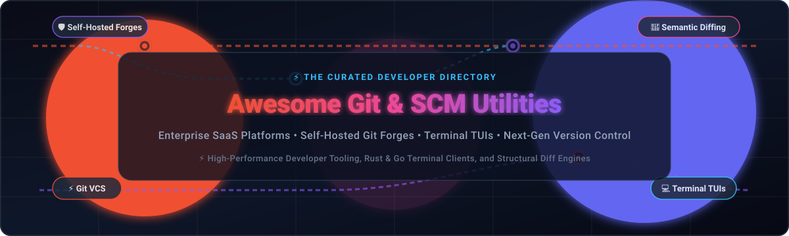

# 🚀 Awesome Source Code Management & Git Utilities Ecosystem

  

  
  
  
  
  

---

## 📖 Curated Directory of SaaS Code Hosting Platforms & Open-Source Git Utilities

> **A comprehensive, SEO-optimized, community-maintained collection of Source Code Management (SCM) platforms, self-hosted Git forges, modern terminal Git TUIs, next-generation distributed VCS engines, semantic diff pagers, and code-review utilities.**

*Last updated: November 2026*

Modern software development relies heavily on **Source Code Management (SCM)**, **Distributed Version Control Systems (DVCS)**, and **Developer Productivity Tooling**. From hyperscale multi-tenant cloud forges to lightning-fast keyboard-driven terminal UIs written in Rust and Go, this curated list equips engineering leaders, DevOps architects, and open-source maintainers with the best tools available.

---

## 📑 Table of Contents

- [📊 Sector Overview & Market Dynamics](#-sector-overview--market-dynamics)
- [☁️ SaaS & Hosted SCM Platforms](#️-saas--hosted-scm-platforms)
- [💻 Open-Source GitHub Projects](#-open-source-github-projects)
- [💡 How to Contribute](#-how-to-contribute)
- [💖 Support & Sponsorship](#-support--sponsorship)
- [📈 Star History](#-star-history)
- [📜 Disclaimer](#-disclaimer)

---

## 📊 Sector Overview & Market Dynamics

The global Source Code Management and DevOps platforms market is valued at approximately **$9.5 billion to $11.2 billion** and is projected to expand at a compound annual growth rate (CAGR) exceeding **18.5%** through 2030, accelerated by cloud-native CI/CD adoption, DevSecOps integration, and generative AI coding assistants. 

The hosted SCM sector exhibits a **highly concentrated, winner-take-most dynamic** among cloud providers—dominated by Microsoft (GitHub, Azure Repos), Alphabet/AWS, and GitLab—while the developer tooling and local workflow tier remains **vibrantly fragmented**, fostering rapid innovation in self-hosted federated Git forges (Forgejo, Gitea), modern distributed VCS architectures (Jujutsu), and high-throughput terminal interfaces (Lazygit, GitUI).

---

## ☁️ SaaS & Hosted SCM Platforms

The table below lists leading SaaS and managed code hosting platforms, sorted in descending order by parent company scale (valuation / annual revenue).

| 🏢 Platform | 💰 Starting Paid Tier Price | 🎁 Free Tier / Free Trial Limits | 📈 Company Scale (Valuation / Revenue) | 📝 Description |
| :--- | :--- | :--- | :--- | :--- |
| **[Azure DevOps (Azure Repos)](https://azure.microsoft.com/services/devops/)** | **$6.00** / user / month (Basic plan) | **Free forever** for up to 5 users (Unlimited private Git repos, 2 GB artifact storage, 1 free Microsoft-hosted CI/CD parallel job with 1,800 min/mo) | **$3.1+ Trillion** (Parent: Microsoft Corporation) | Enterprise cloud ALM and Git hosting suite offering unlimited repositories, pull request policies, and Azure Pipelines. |
| **[GitHub](https://github.com/)** | **$4.00** / user / month (Team plan) | **Free forever** with unlimited public/private repositories, 500 MB package storage, and 2,000 CI/CD Actions minutes/month | **$100+ Billion** (Subsidiary of Microsoft; $1B+ ARR) | World's largest cloud code hosting & collaboration platform featuring Pull Requests, Actions CI/CD, and Copilot. |
| **[AWS CodeCommit](https://aws.amazon.com/codecommit/)** | **$1.00** / additional active user / month | **Free forever** for up to 5 active users/month, 50 GB/month storage, and 10,000 Git requests/month | **$2.2+ Trillion** (Parent: Amazon / AWS) | Highly scalable, fully managed source control service hosting secure Git repositories deeply integrated with AWS IAM. |
| **[Bitbucket Cloud](https://bitbucket.org)** | **$3.00** / user / month (Standard plan) | **Free forever** for up to 5 users, 1 GB repository storage limit, and 50 CI/CD build minutes/month | **$40+ Billion** (Parent: Atlassian Corporation) | Atlassian's cloud Git platform engineered for seamless Jira, Confluence, and enterprise agile project tracking workflows. |
| **[Unity Version Control (Plastic SCM)](https://unity.com/products/version-control)** | **$7.00** / user / month (Cloud Edition starting tier) | **Free forever** for up to 3 users with 5 GB cloud storage included | **$8+ Billion** (Parent: Unity Software Inc.) | Version control system specifically optimized for game engines, massive binary assets, 3D artists, and distributed software teams. |
| **[GitLab (SaaS)](https://gitlab.com)** | **$29.00** / user / month (Premium plan) | **Free forever** with 5 users per namespace, 5 GB storage, 10 GB transfer/month, and 400 compute minutes/month | **$7+ Billion** (Public: NASDAQ: GTLB; ~$600M+ ARR) | Comprehensive single-tenant/multi-tenant DevSecOps platform integrating Git repository management, CI/CD, and security scanning. |
| **[Launchpad](https://launchpad.net)** | **Free / Canonical Enterprise Support** (Commercial support bundles) | **100% Free forever** for all open-source & public projects (Ubuntu PPA hosting, Git/Bazaar hosting, bug trackers) | **$3+ Billion** (Parent: Canonical Ltd.) | Canonical's collaboration and code hosting suite supporting Git & Bazaar repositories, Ubuntu PPA package builds, and issue tracking. |
| **[SourceForge](https://sourceforge.net)** | **Free / Ad-Supported** (Enterprise commercial distributions upon inquiry) | **100% Free forever** with unlimited repositories, project web hosting, and downloads for open-source projects | **$500+ Million** (Parent: Slashdot Media / BizzClick) | Iconic web-based source code repository and binary software distribution mirror supporting Git, SVN, and Mercurial. |
| **[RhodeCode](https://rhodecode.com)** | **$8.00** / user / month (Standard Enterprise edition, billed annually) | **30-Day Free Trial** with full enterprise features for up to 10 users; Free Community Edition self-hosted | **$15+ Million** (Privately held venture-backed entity) | Enterprise-grade source code management platform securing Git, Mercurial, and Subversion behind unified access control. |
| **[Gitea Cloud](https://gitea.com)** | **$5.00** / user / month (Standard managed instance) | **14-Day Free Trial** with full managed access; Free Community Edition self-hosted | **$10+ Million** (Bootstrapped / Gitea Ltd.) | Fully managed, high-speed cloud hosting service for Gitea offering instant Git repositories and automated CI runners. |

---

## 💻 Open-Source GitHub Projects

Explore the most popular open-source Git utilities, terminal interfaces, self-hosted forges, and semantic diff tools, sorted by GitHub stargazers count (descending).

| 📦 Repository & Tool | 🌟 Star Count | 🏷️ Primary Category | 📝 Description |
| :--- | :--- | :--- | :--- |
| **[jesseduffield/lazygit](https://github.com/jesseduffield/lazygit)**  | `84,000+` | 💻 Terminal Git TUI | Simple, blazing-fast terminal UI for Git commands written in Go enabling keyboard-driven staging, rebasing, and branch navigation. |
| **[nektos/act](https://github.com/nektos/act)**  | `72,700+` | ⚙️ Local CI/CD Runner | Run your GitHub Actions locally in Docker containers for rapid workflow iteration without pushing commits. |
| **[git/git](https://github.com/git/git)**  | `64,400+` | 🌐 Core Distributed VCS | The foundational distributed version control system engineered for speed, data integrity, and non-linear branching workflows. |
| **[go-gitea/gitea](https://github.com/go-gitea/gitea)**  | `59,200+` | 🛡️ Self-Hosted Git Forge | Painless, single-binary self-hosted Git service written in Go featuring pull requests, issue tracking, and built-in CI/CD runners. |
| **[cli/cli](https://github.com/cli/cli)**  | `47,100+` | ⌨️ Official CLI Client | GitHub's official command-line tool bringing pull requests, issues, releases, and GitHub Actions directly to your terminal. |
| **[dandavison/delta](https://github.com/dandavison/delta)**  | `32,800+` | 🎨 Syntax-Highlighting Pager | A syntax-highlighting pager for git, diff, and grep output written in Rust featuring side-by-side diffs and word-level granularity. |
| **[jj-vcs/jj](https://github.com/jj-vcs/jj)**  | `32,500+` | ⚡ Next-Gen DVCS | Next-generation Git-compatible distributed version control system written in Rust with first-class conflict recording and operation undo log. |
| **[gitleaks/gitleaks](https://github.com/gitleaks/gitleaks)**  | `31,200+` | 🔒 Secret Scanner & Security | Blazing-fast static analysis tool designed to find and prevent secrets, API tokens, and passwords in Git repositories. |
| **[Wilfred/difftastic](https://github.com/Wilfred/difftastic)**  | `26,200+` | 🌳 AST Structural Diff | Structural diff tool written in Rust that compares code using tree-sitter AST syntax trees rather than line-by-line matching. |
| **[gitlabhq/gitlabhq](https://github.com/gitlabhq/gitlabhq)**  | `24,500+` | 🛡️ Open-Core DevSecOps Forge | Complete DevOps platform delivered as a single application for source code management, code review, issue tracking, and CI/CD. |
| **[gitui-org/gitui](https://github.com/gitui-org/gitui)**  | `22,600+` | 💻 Terminal Git TUI | Blazing-fast terminal user interface for Git written in Rust providing instantaneous feedback even on massive enterprise repos. |
| **[tj/git-extras](https://github.com/tj/git-extras)**  | `18,100+` | 🧰 Git CLI Extensions | Powerful collection of 60+ Git shell utilities providing shorthand commands for repo summarization, reflog cleanup, and branching. |
| **[so-fancy/diff-so-fancy](https://github.com/so-fancy/diff-so-fancy)**  | `18,100+` | 🎨 Human-Readable Diff Pager | Good-looking diffs for humans that improve visual code clarity in terminal reviews and highlight character-level modifications. |
| **[theonedev/onedev](https://github.com/theonedev/onedev)**  | `15,300+` | 🛡️ Self-Hosted Git Server | All-in-one open-source Git server with built-in CI/CD engine, Kanban issue tracking, symbol-level code search, and custom workflows. |
| **[git-lfs/git-lfs](https://github.com/git-lfs/git-lfs)**  | `14,600+` | 📦 Binary Versioning | Git Large File Storage client replaces large binary audio, video, and dataset files with lightweight text pointers inside Git. |
| **[jonas/tig](https://github.com/jonas/tig)**  | `13,300+` | 💻 Ncurses Git Client | Text-mode ncurses interface for Git acting as a repository browser, interactive staging area, and commit graph navigator. |
| **[dlvhdr/gh-dash](https://github.com/dlvhdr/gh-dash)**  | `12,700+` | 📊 GitHub TUI Dashboard | A rich terminal user interface for GitHub that organizes your pull requests, issues, and notifications without leaving the shell. |
| **[orhun/git-cliff](https://github.com/orhun/git-cliff)**  | `12,400+` | 📝 Changelog Generator | Highly customizable changelog generator written in Rust that parses Conventional Commits and generates Markdown release notes. |
| **[rtyley/bfg-repo-cleaner](https://github.com/rtyley/bfg-repo-cleaner)**  | `12,200+` | 🧹 History Cleaner | Simpler, 10–720x faster alternative to `git-filter-branch` for removing large files or sensitive credentials from Git history. |
| **[libgit2/libgit2](https://github.com/libgit2/libgit2)**  | `10,600+` | 📚 C Core Library | Pure C implementation of the Git core methods suitable for embedding version control capabilities into custom software products. |
| **[AGWA/git-crypt](https://github.com/AGWA/git-crypt)**  | `10,000+` | 🔐 Repository Encryption | Transparent file encryption in Git allowing sensitive configs or keys to be safely committed alongside public repository files. |
| **[gitextensions/gitextensions](https://github.com/gitextensions/gitextensions)**  | `8,600+` | 🖥️ Desktop GUI Client | Standalone UI tool for managing Git repositories on Windows, macOS, and Linux with commit tree exploration and visual merge tools. |
| **[isomorphic-git/isomorphic-git](https://github.com/isomorphic-git/isomorphic-git)**  | `8,300+` | 🌐 Pure JavaScript Git | A pure JavaScript implementation of Git for Node.js and web browsers enabling in-browser cloning, editing, and committing. |
| **[charmbracelet/soft-serve](https://github.com/charmbracelet/soft-serve)**  | `7,200+` | 🍦 Minimal SSH Git Server | A delightful, self-hostable Git server for the command line with an interactive TUI accessible directly over SSH. |
| **[git-cola/git-cola](https://github.com/git-cola/git-cola)**  | `2,500+` | 🖥️ Python Qt GUI Client | Sleek and powerful graphical user interface for Git written in Python and Qt with custom actions and staging hotkeys. |
| **[radicle-dev/heartwood](https://github.com/radicle-dev/heartwood)**  | `270+` | 🌐 P2P Decentralized VCS | Peer-to-peer code collaboration network built on top of Git utilizing cryptographic identity, gossiping protocols, and local-first storage. |

---

## 💡 How to Contribute

Contributions are warmly welcome! Please follow these steps:

1. 🍴 **Fork** this repository.
2. 🌿 **Create a feature branch** (`git checkout -b feature/new-git-tool`).
3. ✍️ **Add or edit entries** in `README.md` maintaining factual, concise descriptions and tabular ordering.
4. 🚀 **Submit a Pull Request** with a brief overview of why the tool is valuable to developers.

---

## 💖 Support & Sponsorship

If you find this curated collection of **Source Code Management & Git Utilities** helpful for your developer workflow, please consider supporting the project:

- ⭐ **Star this repository** to help other engineers discover it!
- 🍴 **Fork and contribute** your favorite Git tooling and CLI extensions.
- 📢 **Share** with your engineering team and developer communities.
- ☕ **Buy a coffee & sponsor** ongoing maintenance via the [GitHub Sponsor Dashboard](https://github.com/sponsors/ishandutta2007).

Thank you for championing open-source software, high-speed development, and sovereign code hosting! 🚀

---

## 📈 Star History

---

## 📜 Disclaimer

- This is an independent, **community-curated** resource directory intended for informational and educational purposes.
- Always enforce SSH key signing, GPG commit verification, and branch protection policies on production repositories.
- When installing third-party command-line utilities, TUIs, or desktop clients, verify binary release signatures and repository integrity.
